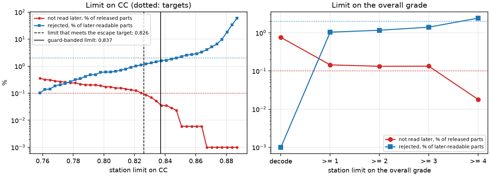

# datamatrix-mark-verification-station

Read-back limit and PLC handshake for a station that laser-marks a Data Matrix code (ECC 200) on a painted plastic part, reads it back and releases the part.

> **Simulated study, no hardware.** The laser, the paint, the readers, the drift and every "measurement" here are models. Nothing was marked, read or measured. The Siemens SCL blocks compile in TIA Portal V18 with 0 errors and 0 warnings (record in `results/tia_compile.txt`); in the tests they run through a small translator. A self-checking test bench with these blocks ran in S7-PLCSIM Advanced under TIA Portal V20: 21 of 21 cases passed ([docs/PLCSIM_RUN.md](docs/PLCSIM_RUN.md)). That is a simulated CPU; the blocks never ran on a real PLC. Relations come from the sources in [docs/SOURCES.md](docs/SOURCES.md); every parameter value is illustrative unless that file names a source for it. ISO/IEC 16022, 15415 and 29158 are paywalled and were not read: their content is used only as printed in the public sources listed there.

## The question

Which read-back limit at the station keeps codes that a later, weaker reader cannot read from leaving, without scrapping good parts, as the marking process drifts? And what must the PLC do so that the right job goes on the right part exactly once?

The scenario comes from a public bachelor thesis on industrial marking (S1): a laser controller holds more than 300 marking jobs and a PLC calls the job that belongs to the part. The painted part, the read-back and the handshake are my additions.

Targets used throughout: at most **0.1 %** of released parts unreadable at the later reader, at most **2 %** of later-readable parts rejected at the station.

## The answer

1. **The mark fails like a cliff, and the paint and the focus decide where.** With the illustrative laser (waist 25.7 um, Rayleigh range 1.30 mm) one pulse opens a 62.5 um spot and the fill removes 41.3 um, twice the 20 um paint. The removed depth stays above the paint thickness up to 3.9 mm of focus offset at full pulse energy, 3.0 mm at 75 % and 1.75 mm at 50 %. In the simulated sweeps the station decodes every part up to 3.0 mm and 23 % at 4.0 mm; every part up to 30 um of paint and 40 % at 40 um.

2. **The grade scale cannot see the drift; the raw cell contrast can.** In a drifting population of 6,000 parts the station decodes 97.63 %. Every decoded part has grade 4 for cell contrast (the grade needs 0.30; the nominal value is 0.888). The raw cell contrast is still the best single predictor of a later no-read: area under the ROC curve 0.996, against 0.990 for the lowest cell modulation, 0.840 for unused error correction and 0.479 for symbol contrast (no information). **Deciding parameter: cell contrast measured at the station, as a value, with a limit tied to the process's own nominal, not to a grade.**

3. **Trade study on the same parts.** Share of released parts the later reader cannot read / share of later-readable parts rejected:

   | Alternative | Not read later | Rejected though readable | Meets both targets |
   |---|---|---|---|
   | A0 no read-back | 3.11 % | 0 | no |
   | A1 decode only | 0.76 % | 0 | no |
   | A2 overall grade >= 2 | 0.13 % | 1.17 % | no |
   | A2 overall grade >= 4 | 0.018 % | 2.43 % | no |
   | A3 grade >= 2 and unused error correction >= 0.84 | 0.13 % | 1.31 % | no |
   | A4 cell contrast >= 0.826 | 0.087 % | 1.19 % | yes |
   | A5 cell contrast >= 0.837 (guard-banded) | 0.035 % | 1.59 % | yes |

   Decode-only lets almost eight in a thousand through. A fixed grade limit of 1, 2 or 3 gives almost the same result (0.145 %, 0.133 %, 0.134 %). Grade 4 meets the escape target but rejects too much: when the overall grade falls below 4 it is mostly the fixed-pattern check that sets it (118 of 185 parts), and going from grade 3 to grade 4 raises the rejects of later-readable parts from 1.41 % to 2.43 %.

4. **An error-correction margin adds nothing at this station.** Adding "unused error correction >= 0.84" to grade >= 2 leaves the escapes where they were (0.133 %) and raises the rejects from 1.17 % to 1.31 %. The station reader is so much better than the later one that it still reads every module when the later reader already fails: the median unused error correction stays at 1.0 in every sweep point except the last one (paint 40 um).

5. **The guard band is for calibration, not for noise.** Repeated station readings of one mark scatter by 0.0007 in cell contrast (1 sigma, 24 marks x 10 reads). The limit that just meets the escape target is 0.826. The guard-banded limit is 0.837: two sigma (0.0014) plus an assumed 0.01 for drift of the station's contrast reading between checks. If the station reads 0.01 too high, the limit without guard band lets 0.139 % through and misses the target; the guard-banded one stays at 0.087 %.

6. **PLC: no part leaves with a wrong, duplicate or unrecorded code under any single fault, by exhaustive search.** The SCL block is run call by call against a non-deterministic model of marker, reader, record store, part and supply. With six parts per run the search visits 22,936 states and 34,153 transitions and finds no violation of five properties under nine fault classes (marker does not load, marker hangs, marker fault, stale job, stale serial, both stale, reader no-read, part removed, power loss). To show that the search can fail: six safeguards removed one at a time each give a shortest counterexample of 8 to 16 controller cycles. A seventh, the job and serial echo check before the start, gives none: the read-back compare still stops the part. The echo check is a second line of defence that keeps the part unmarked instead of scrapping it.



*Key figure. Left: limit on the cell contrast value. Right: limit on the overall grade. Dotted lines are the two targets. Points at 0.001 % are zero in the simulation.*

**How far to trust these numbers.** The comparison of rules is the result; the absolute rates are not. They follow from an assumed drift mix. The low escape rates rest on few events: 6,000 parts with three later reads each, so 0.087 % is 15 failed reads, 0.035 % is 6 and 0.018 % is 3. The limit 0.826 was chosen on the same parts it is evaluated on.

## Figures

All produced by `python scripts/run_all.py`:

- [fig1_symbols_nominal_and_degraded.png](docs/img/fig1_symbols_nominal_and_degraded.png): the encoded symbol, the simulated mark, the station image and the later reader's image for the nominal process and four degraded ones.
- [fig2_beam_spot_and_removed_depth.png](docs/img/fig2_beam_spot_and_removed_depth.png): beam radius, ablated diameter and removed depth against focus offset.
- [fig3_grades_vs_drift.png](docs/img/fig3_grades_vs_drift.png): cell contrast, cell modulation, unused error correction, station grade and both read rates against focus, pulse energy, window transmission and paint thickness.
- [fig4_escape_and_false_reject_vs_limit.png](docs/img/fig4_escape_and_false_reject_vs_limit.png): escapes and false rejects against the station limit.
- [fig5_trade_study.png](docs/img/fig5_trade_study.png): all alternatives in the escape / false-reject plane.
- [fig6_deciding_parameter.png](docs/img/fig6_deciding_parameter.png): how well each station value predicts a later no-read, and cell contrast against the later no-read share for every part.
- [fig7_handshake_state_space.png](docs/img/fig7_handshake_state_space.png): reachable states by injected fault, and size of the state space against parts per run.

Counterexample traces for the removed safeguards: [results/handshake_exploration.md](results/handshake_exploration.md). Full report: **[DOSSIER.md](DOSSIER.md)**.

## What is in it

| Part | What | Where |
|---|---|---|
| Symbology | ECC 200 encoder and decoder: ASCII encodation, Reed-Solomon over GF(256), codeword placement, square sizes 10x10 to 48x48. No barcode library in the main path | `dmx/ecc200.py` |
| Mark | Gaussian beam against focus offset, single-pulse ablation diameter and depth, paint opened where the removed depth exceeds the film, texture and film-build variation | `dmx/mark.py` |
| Reader | Lighting gradient, glare, blur, sampling, noise; a simple locator; module sampling; two thresholds | `dmx/reader.py` |
| Grading | Symbol contrast, modulation, cell contrast, cell modulation, fixed pattern damage, unused error correction, axial and grid non-uniformity, print growth, overall grade as the minimum | `dmx/grading.py` |
| Study | Drift mix, sweeps, acceptance rules, both error rates | `dmx/study.py`, `scripts/run_all.py` |
| PLC | Job selection from a 320-row recipe table, code content builder, marking sequence with retentive serial counter | `plc/FB_JobSelect.scl`, `plc/FB_CodeContent.scl`, `plc/FB_MarkStation.scl` |
| SCL in the loop | Translator that executes the SCL source text; exhaustive state-space search with mutants | `dmx/scl.py`, `dmx/explore.py` |
| PLC test bench | Self-checking bench for S7-PLCSIM: SCL stand-ins for marker, reader and record store, 21 cases with expected values generated from the Python model, result data block, OB1 | `plc/test/`, `dmx/bench.py`, [docs/PLCSIM_RUN.md](docs/PLCSIM_RUN.md) |
| Tests | Published vectors, an independent library (tests only), closed forms, published grade tables, SCL blocks, the search, the PLC test bench through the translator | `tests/` |

## How to run

```
python -m venv .venv && .venv/Scripts/pip install -r requirements.txt     (Linux/macOS: .venv/bin/pip)
.venv/Scripts/python -m pytest -q
.venv/Scripts/python scripts/run_all.py
```

The last command rewrites `results/` and `docs/img/` (about two minutes on four cores; `--quick` runs a smaller study for CI). All numbers in this README come from `results/summary.json`.

## Assumptions

- A light paint over black plastic; the laser removes the paint. S1 describes this technique for a coated part; paint is my choice.
- One 16x16 symbol, 0.25 mm modules, 19 digits: part number, variant, serial.
- Laser wavelength, working distance, beam diameter and marking speed are from S1. Beam quality, pulse energy, repetition rate, hatch, ablation threshold, penetration depth, paint thickness and reflectances are illustrative.
- Craters add linearly. No incubation, no plume shielding, no heat build-up, no charring of the plastic.
- The later reader has half the resolution, more blur, more noise, a stronger lighting gradient, glare and a mid-range threshold. The station reader has a diffuse light and a minimum-variance threshold.
- Each drift mechanism follows its own Beta(1, 5) level between nominal and a full-scale value (focus 4 mm, pulse energy 50 %, window 50 %, paint 40 um).
- The marker and reader protocol is a stand-in. The real marker protocol is not public.

## Not verified, not done

- No real mark, no real reader, no verifier. The station grades are an in-line indication, not a formal verification: no calibrated reflectance, one image instead of five rotations, no reference decode algorithm.
- Grading is simplified where public sources stop: no transition-ratio test in fixed pattern damage, no minimum-reflectance grade, cell modulation graded on the modulation scale. See DOSSIER section 7.3.
- The locator assumes an axis-aligned symbol. Rotation and perspective are not modelled.
- Only ASCII encodation, single-block square symbols and errors-only decoding.
- The SCL blocks compile in TIA Portal V18 for an S7-1513 with 0 errors and 0 warnings (`scripts/tia_build.ps1`, record in `results/tia_compile.txt`). The blocks never ran on a real PLC. The self-checking test project compiles in V18 with 0 errors and 0 warnings (`results/tia_compile_testbench.txt`), and its 21 cases pass when the same sources run through the translator. On 25 November 2026 its archive was opened in TIA Portal V20 Update 7, which upgraded the project from V18, compiled there (software 0 errors and 0 warnings; hardware 0 errors and the same 2 warnings about missing passwords) and run in S7-PLCSIM Advanced V7.0 Upd1: `Done` and `AllPassed` TRUE, 21 of 21 cases passed, 803 bench calls as in the translator. Record and screenshots: [docs/PLCSIM_RUN.md](docs/PLCSIM_RUN.md). The simulated CPU has no I/O, no real timing and no power loss.
- The state-space search covers one fault per run, power loss only between controller cycles, parts at least one cycle apart, shortened time-outs, and a reader that never returns a wrong but valid code. Liveness is not checked.
- No aging of the mark in the field (scratches, dirt, UV).

MIT licence.
