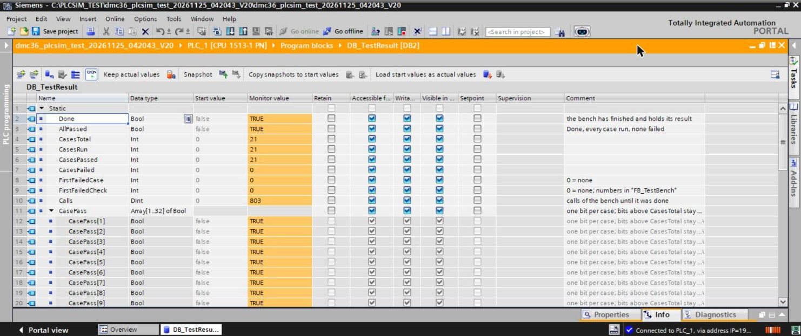
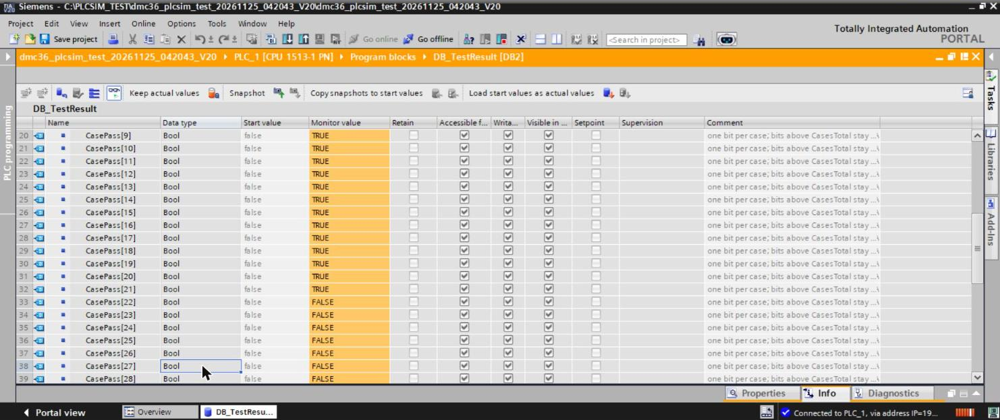
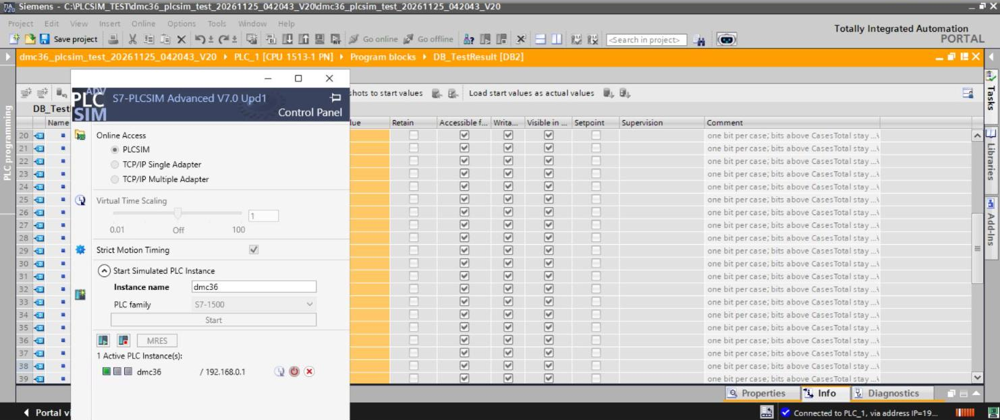

# Running the compiled blocks in S7-PLCSIM

**Status: run in S7-PLCSIM Advanced on 25 November 2026. 21 of 21 cases passed, `Calls` = 803.** The record is the last section, "Observed in PLCSIM". Everything above that section was written before the run and without PLCSIM; where the run went differently, the record says so. A simulated CPU is not a real PLC: no I/O, no real timing, no power loss.

## What the bench does

`plc/test/` holds a test bench that runs inside the PLC with no outside stimulus.

- `FB_TestBench` is called once per cycle from OB1 (`Main`).
- It first loads the 320-row recipe table into `FB_JobSelect`, one row per call.
- Then it runs 21 cases one after the other. In each case parts arrive in the nest, `FB_MarkStation` works against three small stand-ins (`FB_SimMarker`, `FB_SimReader`, `FB_SimRecords`), and one fault may be injected: no-read, marker time-out, stale job, stale serial, part taken out, slow record store. `FB_CodeContent` builds the code content for every start command.
- After each case it compares eleven values with the expected ones (parts released, rejected and taken out, alarm codes, start commands, job numbers, last serial, good and void records, recorded serials, checksum of the code content) and checks that no released part carries a wrong code.
- When all cases are through it stops calling the blocks and holds the result. OB1 copies the result into `DB_TestResult` in every cycle.

The expected values are not typed by hand and do not come from the SCL stand-ins. `scripts/make_testbench.py` generates them from the Python model (`dmx/bench.py`: the environment of the state-space search with the station block in the loop, and the Python encoder for the code content) and writes them into `plc/test/FB_BenchCases.scl`. The cases and their numbers are listed in [results/testbench_cases.md](../results/testbench_cases.md).

The bench does not cut the power. A restart with an open cycle is covered by the state-space search and by `tests/test_plc.py`, not here.

## What is known before PLCSIM

- **Translator.** The same source text runs through the repo's translator in `tests/test_testbench.py` and in CI: 21 of 21 cases pass, 803 calls. With one safeguard removed from the station block the bench fails, with a wrong expected value it names the case and the check, and a station that hangs ends in check 13.
- **TIA Portal V18.** `scripts/tia_build.ps1` generates all blocks, both data blocks and OB1 from the sources and compiles them for the CPU 1513-1 PN (6ES7 513-1AL02-0AB0, V2.9). Record: [results/tia_compile_testbench.txt](../results/tia_compile_testbench.txt). Software: 0 errors, 0 warnings. Hardware: 0 errors, 2 warnings, both about missing passwords (see below).

What PLCSIM adds: the code that the TIA compiler generated is executed, instead of the translator's reading of the source.

## Settings of the test project

Three settings differ from a new project, so that the project loads into PLCSIM without a wizard. They are set by the build script and written into the compile record. They belong to this simulation project only; do not copy them to a real PLC.

| Setting | Value | Why |
|---|---|---|
| Project > Properties > Protection: "Support simulation during block compilation" | on | PLCSIM needs it |
| CPU > Protection & Security: protection of confidential PLC configuration data | switched off (Openness `Unprotect()`; the record prints the state `None`) | without a decision the hardware does not compile |
| CPU > Protection & Security > Access level | full access, no password (record: `NoAccess -> FullAccess`) | the default asks for a password and does not compile without one |

The two hardware warnings ("PLC_1 does not contain a configured protection level", "CPU display does not contain any password protection") follow from this and are expected.

## How to run

The menu names below are written from memory of TIA Portal V18; they were not checked on a screen for this document.

The archive is not in the repo. It is written to `C:\TIA_build\plcsim\dmc36_plcsim_test.zap18` by the build command in the header of `scripts/tia_build.ps1` (usage 2).

1. TIA Portal V18: **Project > Retrieve**, choose `dmc36_plcsim_test.zap18`, choose a target folder. The project opens.
2. Select **PLC_1** in the project tree. **Online > Simulation > Start**. Confirm the note about disabling other online interfaces. PLCSIM starts.
3. In the load dialog: **Start search**, select the simulated CPU, **Load**. In the preview: **Load**. At the end choose **Start module** and **Finish**. The CPU goes to RUN.
4. In the project tree open **PLC_1 > Program blocks > DB_TestResult**. Click **Monitor all** (the glasses icon).
5. Compare the column "Monitor value" with the table below. The bench is finished long before the block is open: it needs 803 cycles.

Not checked on the build machine, because PLCSIM is not installed there: whether PLCSIM in the target installation accepts the firmware V2.9 CPU with secure PG/PC communication as it is, or asks for one more confirmation in the load dialog. The run answered it: one more confirmation, see the record.

## Values that mean pass

| Tag in `DB_TestResult` | Expected |
|---|---|
| `Done` | TRUE |
| `AllPassed` | TRUE |
| `CasesTotal` | 21 |
| `CasesRun` | 21 |
| `CasesPassed` | 21 |
| `CasesFailed` | 0 |
| `FirstFailedCase` | 0 |
| `FirstFailedCheck` | 0 |
| `Calls` | 803 |
| `CasePass[1]` to `CasePass[21]` | TRUE |
| `CasePass[22]` to `CasePass[32]` | FALSE (not used) |

`Calls` is the number of bench calls until it was done. It must be exactly 803, the same as in the translator: one more or one less means the compiled blocks took a different path.

If it does not pass: `FirstFailedCase` is the case number in [results/testbench_cases.md](../results/testbench_cases.md). `FirstFailedCheck` is the check:

| No. | Check | No. | Check |
|---|---|---|---|
| 1 | parts released | 8 | good records |
| 2 | parts rejected | 9 | void records |
| 3 | parts taken out | 10 | sum of recorded serials |
| 4 | sum of alarm codes | 11 | checksum of the code content |
| 5 | start commands | 12 | released parts with a wrong code (must be 0) |
| 6 | sum of job numbers | 13 | case not finished within 400 calls |
| 7 | last serial | | |

`Done` = FALSE after a few seconds in RUN means the bench is not being called or the CPU is in STOP. The actual values of the run are in the instance data block `DB_TestBench` (static part: `NReleased`, `AlarmSum`, `CaseIx` and so on).

## Observed in PLCSIM

Run on 25 November 2026 on a second installation, not on the build machine. That installation has TIA Portal V20 and S7-PLCSIM Advanced; it has neither TIA Portal V18 nor the standard S7-PLCSIM.

| | |
|---|---|
| Date | 2026-11-25 |
| TIA Portal | Totally Integrated Automation Portal, Version V20 Update 7; STEP 7 Professional, Version V20 Update 7 (as listed under "Installed software") |
| PLCSIM | S7-PLCSIM Advanced V7.0 Upd1 (title of its control panel). Online access "PLCSIM", one instance, PLC family S7-1500 |
| Archive | `dmc36_plcsim_test.zap18`, built with TIA Portal V18 by `scripts/tia_build.ps1` |
| Upgrade | TIA Portal V20 reported "The project has a TIA Portal project version V18" and upgraded the project to V20 before it opened. The run therefore executed code generated by the V20 compiler, not by the V18 compiler of the build record |
| V20 compile, hardware (rebuild all) | 0 errors, 2 warnings: "PLC_1 does not contain a configured protection level" and "The S7-1500 CPU display does not contain any password protection." These are the two warnings of the V18 record |
| V20 compile, software (rebuild all) | 0 errors, 0 warnings. All 11 blocks: "Block was successfully compiled." |
| Load | "Loading completed (errors: 0; warnings: 0)", then "PLC_1 started." The instance showed RUN (green) at 192.168.0.1 |

What differed from "How to run":

- The V20 Project menu showed no "Retrieve" entry with no project open. **Project > Open > Browse** accepts the `.zap18` file, asks for a target directory and retrieves it.
- There is no "Online > Simulation > Start" path into S7-PLCSIM Advanced. The instance was created and started in the S7-PLCSIM Advanced control panel first. Then **Online > Extended download to device**, PN/IE, PG/PC interface PLCSIM: the search found one device, "CPUcommon", at 192.168.0.1.
- One more confirmation came up, the point left open above: "Establish connection to device", with the text that "PLC_1" might not be a trustworthy device (the IP address does not match the certificate; unknown, self-signed certificate). Answered with **Connect**.
- The load preview said "The loading will be performed from a simulated PLC." and needed no further choice. In the load results the action for "Start modules" stood at "No action" and was set to **Start module**.
- The three project settings of the table above came with the archive. No project setting had to be changed by hand.

Monitor values of `DB_TestResult` ("Monitor all", CPU in RUN):

| Tag | Expected | Observed |
|---|---|---|
| `Done` | TRUE | TRUE |
| `AllPassed` | TRUE | TRUE |
| `CasesTotal` | 21 | 21 |
| `CasesRun` | 21 | 21 |
| `CasesPassed` | 21 | 21 |
| `CasesFailed` | 0 | 0 |
| `FirstFailedCase` | 0 | 0 |
| `FirstFailedCheck` | 0 | 0 |
| `Calls` | 803 | 803 |
| `CasePass[1]` to `CasePass[21]` | TRUE | TRUE, all 21 |
| `CasePass[22]` to `CasePass[32]` | FALSE | FALSE for `[22]` to `[28]`, which were on the screen; `[29]` to `[32]` were not scrolled into view |

Result: pass. 21 of 21 cases, and the number of bench calls is the one the translator gives.

What this does and does not show. It shows that the blocks, compiled by TIA Portal V20 for the CPU 1513-1 PN and executed by the simulated S7-1500, take the same path through all 21 cases as the Python model predicts. It does not show anything about a real PLC, real I/O, cycle time, the marker's or the reader's real protocol, or a power loss.

`DB_TestResult` in "Monitor all", scalar values and the first cases:

The same block scrolled down, `CasePass[9]` to `CasePass[28]`:

S7-PLCSIM Advanced control panel with the instance in RUN, in front of the monitored block:

